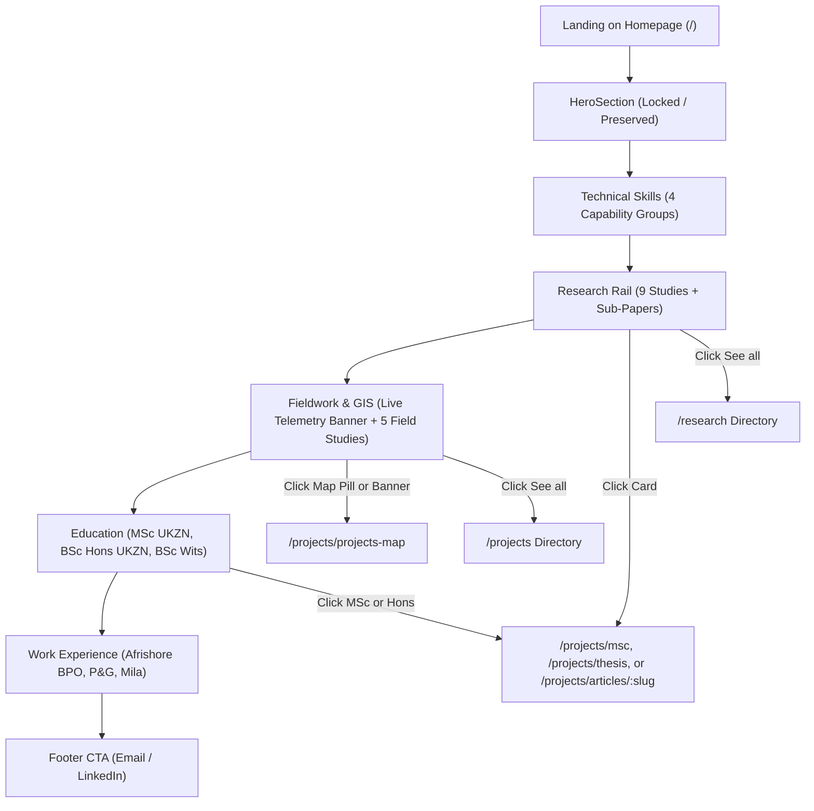
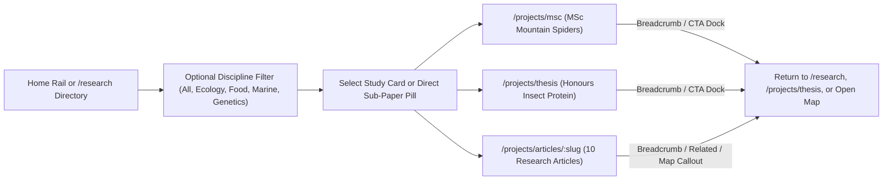
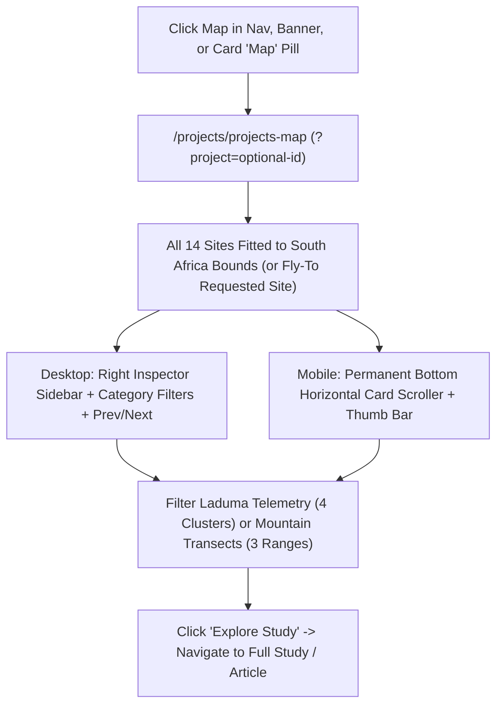

# UX, Information Architecture & Visual Design Review (`DESIGN_REVIEW.md`)

## 1. Intended Audience, Primary Tasks & Assumptions

### Intended Audience (from existing codebase evidence)
1. **Academic Supervisors, Principal Investigators & Grant Committees (UKZN, Wits, SANBI, NRF)**:
   - Evaluating Andiswa Masuku's MSc research on mountain spider climate shifts, BSc Honours thesis on insect protein fortification, and undergraduate research papers across ecology, marine biology, physiology, and forensic genetics.
2. **Environmental Consultancies, Conservation NGOs & GIS / Data Science Hiring Managers**:
   - Assessing technical proficiency in R (`sf`, `terra`, `ggplot2`, MaxEnt), QGIS/ArcGIS Pro, wildlife GPS telemetry (1,749 caracal collar points), field sampling transects, and corporate analytics experience (Procter & Gamble, Afrishore BPO).
3. **Collaborators & Peers**:
   - Browsing specific field sites on the interactive South African Research Map (`/projects/projects-map`) and reading digestible research articles (`/projects/articles/:slug`).

### Primary User Tasks
- **Task 1 — Rapid Credential & Capability Scan**: Understand Andiswa's academic pedigree (MSc Ecology at UKZN, BSc Honours at UKZN, BSc at Wits), core technical skills, and work history within 30 seconds on the homepage.
- **Task 2 — Academic Research Deep-Dive**: Discover and read flagship studies (`/projects/msc` and `/projects/thesis`) and peer-style research articles (`/projects/articles/:slug`), including methodology, statistical validation, and conservation significance.
- **Task 3 — Spatial & Fieldwork Exploration**: Inspect real GPS telemetry tracks (`Laduma` caracal study) and elevational sampling stations (`Maloti-Drakensberg`, `Cederberg`, `Soutpansberg`) on the interactive map (`/projects/projects-map`), and jump seamlessly between map sites and written studies.
- **Task 4 — Direct Contact & Outreach**: Initiate email contact (`mailto:`) or open LinkedIn from any point in the journey.

### Flagged Assumptions
- **Hero Preservation Boundary**: The homepage `HeroSection` (`src/components/HeroSection.tsx`) is already approved and locked; all improvements must occur outside `HeroSection.tsx` without indirectly altering its typography, spacing, or animations.
- **Reference Screenshot Adaptation**: The provided screenshot (`Events`, `Top places`, `Best of care` rows) demonstrates an editorial, image-first card language: edge-to-edge rounded photography (`rounded-2xl`) with a single high-contrast translucent overlay pill in the corner (`bottom-left` status/category pill or `bottom-right` location/map action pill like `📍 Directions`), paired with clean, unboxed left-aligned typography directly beneath the image.

---

## 2. User Journey Maps (Mermaid Diagrams)

### Journey A: Homepage Discovery & Credential Scan

### Journey B: Academic Research & Article Deep-Dive

### Journey C: Spatial GIS & Fieldwork Map Exploration

---

## 3. Prioritised Issue Checklist

### Priority 0 — Information Architecture, Findability & Wayfinding (High Impact on Task Completion)
- [x] **P0-1: Hidden Work Experience Descriptions (`src/components/sections/WorkSection.tsx`)**
  - **Issue**: Role descriptions (`Managed 50+ daily client inquiries...`, `Analysed market trends for Sub-Saharan Africa...`) are completely hidden inside a click-only modal, and the `"Details ->"` affordance uses `opacity-0 group-hover:opacity-100` (invisible on touch devices and non-hovered desktop state). Hiring managers scanning the homepage miss critical quantitative impact metrics.
  - **Fix**: Surface the full role description directly inside each Work Experience card in clean left-aligned text while preserving the click-to-inspect modal and making the interactive affordance visible on all devices.
- [x] **P0-2: Missing Top Breadcrumb Wayfinding & Cross-Navigation on `/projects/thesis` (`src/pages/ThesisDetail.tsx`)**
  - **Issue**: Unlike `/projects/msc`, the Honours Thesis page (`/projects/thesis`) has no top breadcrumb back to `/research` or `/projects`, no visual indicator that methodology photos can be enlarged in the lightbox, and no bottom cross-navigation dock to explore the MSc study or Interactive Map.
  - **Fix**: Add a top breadcrumb bar (`Research • Honours Thesis • UKZN 2025`), lightbox zoom badges on interactive photography, and a bottom cross-navigation CTA dock matching `/projects/msc`, while preserving 100% of existing wording and imagery.
- [x] **P0-3: Missing Top Return Path on `/projects/articles/:slug` (`src/pages/ArticlePage.tsx`)**
  - **Issue**: Users landing on an article must scroll all the way to the bottom of the page (or use the global navbar) to return to `/projects` or `/research`.
  - **Fix**: Add a clear, lightweight breadcrumb back-link (`← Projects & Research`) inside the article hero header above the category/read-time badges.
- [x] **P0-4: Hidden Native Cursor on Homepage (`src/pages/Index.tsx` & `src/components/CustomCursor.tsx`)**
  - **Issue**: `cursor-none md:cursor-none` hides the operating system pointer on the homepage, replacing it with a `blend-difference` hollow circle that disappears against mid-tone imagery and reduces targeting precision on small pills and map controls.
  - **Fix**: Restore the native system pointer (`cursor-auto`) so interactive cursor states (`pointer`) work predictably, and keep `CustomCursor` as a subtle, non-blocking trailing ring that respects `prefers-reduced-motion`.

### Priority 1 — Card Treatment, Typography & Visual System (Screenshot Adaptation + Apple/iOS Restraint)
- [x] **P1-1: Global Justified & Hyphenated Text (`src/index.css`)**
  - **Issue**: `body` and `p` globally enforce `text-align: justify; hyphens: auto;` in `src/index.css`. This creates awkward rivers of whitespace and mid-word hyphenation in short card descriptions, subtitles, modal text, and article paragraphs.
  - **Fix**: Remove global `text-align: justify; hyphens: auto;` from `body` and `p` while keeping it explicitly on `.body-text` so `HeroSection.tsx` remains 100% unchanged and all other UI typography is crisp, left-aligned, and readable.
- [x] **P1-2: Unified Contained Editorial Cards on Homepage (`ResearchSection.tsx`, `ProjectsSection.tsx`, `EducationSection.tsx`)**
  - **Issue**: Moving card info outside the cards looked untidy across multi-line academic cards with subtitles, institutions, descriptions, and action pills.
  - **Fix**: Enclose all card imagery, titles, dot-separated metadata, descriptions, tags, and action footers inside unified rounded card containers (`bg-white dark:bg-card border border-slate-200/80 rounded-2xl overflow-hidden shadow-xs hover:shadow-md flex flex-col justify-between h-full`) with edge-to-edge top imagery (`aspect-[16/10]`) and consistent internal padding (`p-4 sm:p-5`).
- [x] **P1-3: Contained Directory Cards on `/research` and `/projects` (`src/pages/Research.tsx`, `src/pages/Projects.tsx`)**
  - **Issue**: Directory cards needed clean containment so multi-line titles, descriptions, skill tags, and actions stay aligned across every row.
  - **Fix**: Enclose `/research` and `/projects` directory cards in unified rounded card containers (`bg-white dark:bg-card border border-slate-200/80 rounded-2xl overflow-hidden shadow-xs hover:shadow-md flex flex-col justify-between h-full`) with corner image overlays (`Map` pill and full-image popout button), crisp left-aligned titles, dot-separated institution/subtitle metadata, skill tags, and aligned bottom footers.

### Priority 2 — Responsive Ergonomics, Accessibility & Polish
- [x] **P2-1: Mobile Bottom Dock Overlap on Sub-Page Footers (`Research.tsx`, `Projects.tsx`, `ThesisDetail.tsx`, `ArticlePage.tsx`, `MscDetail.tsx`)**
  - **Issue**: The fixed mobile bottom navigation dock (`bottom-5`) overlaps the copyright/back-link footer at the bottom of sub-pages on mobile viewports.
  - **Fix**: Add responsive bottom padding (`pb-24 md:pb-8`) to sub-page footers so the floating mobile dock never covers footer content or links.
- [x] **P2-2: Horizontal Rail Scroll Affordances (`ResearchSection.tsx`, `ProjectsSection.tsx`)**
  - **Issue**: Initial scroll state and resize updates should accurately reflect whether the rail can scroll left or right across viewport changes.
  - **Fix**: Check scroll bounds on mount and window resize so left/right arrow states are always accurate.

### Priority 3 — User Follow-Up Refinements & Visual Quality Fixes
- [x] **P3-1: Authentic Mountain Spider Ecological Image (`src/assets/mountain-spiders-climate.webp`)**
  - **Issue**: The previous mountain spider image looked AI-generated and contained gibberish text (`DRK-ECOL-SITE 14` and solar panel labels).
  - **Fix**: Regenerated `src/assets/mountain-spiders-climate.webp` as an authentic, natural-light documentary wildlife/ecological photograph in the Maloti-Drakensberg mountains (morning-dew spider web and mountain spider on weathered alpine basalt rock at sunrise) with zero text, plaques, or artificial equipment, and compressed to `160.4 KB` WebP (down 37% from `255.8 KB`).
- [x] **P3-2: Desktop Map Top-Right `X` Clashing with Scroller (`src/pages/ResearchMap.tsx`)**
  - **Issue**: On desktop viewports at `/projects/projects-map`, the floating top-right `<X />` toggle button (`top-4 right-4 z-[500]`) overlapped the `< 1/14 >` Prev/Next site switcher inside the desktop right sidebar header.
  - **Fix**: Integrated the sidebar close button (`<X size={15} />`) cleanly inside the desktop sidebar header's right-hand flex group alongside the `< 1/14 >` Prev/Next switcher, and only display the floating `Sites (14)` pill in the top-right corner when the sidebar is closed (`!isNavOpen`).
- [x] **P3-3: Contained Card Info Across the Board (`ResearchSection.tsx`, `ProjectsSection.tsx`, `EducationSection.tsx`, `Research.tsx`, `Projects.tsx`, `ThesisDetail.tsx`)**
  - **Issue**: Placing text outside the card container looked untidy when cards had varying text lengths, tags, and action buttons.
  - **Fix**: Wrapped all card content inside unified bordered, rounded card containers (`rounded-2xl overflow-hidden bg-white dark:bg-card border border-slate-200/80 shadow-xs hover:shadow-md flex flex-col justify-between h-full`) with aligned internal padding (`p-4 sm:p-5`) and bottom action footers.
- [x] **P3-4: Frictionless Full-Image Popout Icon + Lightbox (`src/components/ImageLightbox.tsx` & All Card Views)**
  - **Issue**: Because card images contain rich scientific diagrams, charts, and specimens, users need a way to inspect the full-resolution image without interfering with card navigation.
  - **Fix**: Created a lightweight, reusable `ImageLightbox` component (`src/components/ImageLightbox.tsx`) and added a subtle top-right corner popout icon button (`<Maximize2 />`, `z-20`) on card images across `ResearchSection`, `ProjectsSection`, `EducationSection`, `Research`, `Projects`, and `ThesisDetail`.
- [x] **P3-5: Remove Redundant Caracal Map Banner Above Fieldwork Cards (`ProjectsSection.tsx`, `Projects.tsx`)**
  - **Issue**: The Caracal study had both a large standalone banner above the cards and a card in the fieldwork grid/rail, creating redundant links to the map.
  - **Fix**: Removed the redundant top Caracal banner from both the homepage (`ProjectsSection.tsx`, which also eliminated an extra background Leaflet map instance) and `/projects` (`Projects.tsx`), keeping the Caracal study card cleanly in line with the other fieldwork cards.
- [x] **P3-6: Eliminate `Paper 1` + `Explore` Duplication on Single-Paper Cards (`ResearchSection.tsx`, `ProjectsSection.tsx`, `Research.tsx`, `Projects.tsx`)**
  - **Issue**: Studies with only 1 paper (such as the Caracal study) rendered both `Paper 1` and `Explore`, which linked to the exact same destination.
  - **Fix**: Changed the sub-paper pill condition from `articles.length > 0` to `articles.length > 1` across all card views so multi-paper studies show `Paper 1`, `Paper 2`, etc., while single-paper studies show only `Explore`.
- [x] **P3-7: Mobile Thumb-Zone Ergonomics for Lightbox & Modals (`ImageLightbox.tsx`, `MscDetail.tsx`, `ArticlePage.tsx`, `ThesisDetail.tsx`, `WorkSection.tsx`)**
  - **Issue**: Top-right close buttons (`X`) on full-screen image previews and modals require awkward two-handed reach on mobile phones.
  - **Fix**: Positioned the `<ImageLightbox />` close `X` button at the **bottom-right** on mobile (`fixed bottom-6 right-5 md:bottom-auto md:top-6 md:right-6`, 44×44px touch target), unified `MscDetail.tsx`, `ThesisDetail.tsx`, and `ArticlePage.tsx` to use `<ImageLightbox />` so every expanded photo across the entire site follows the mobile thumb rule, and added a bottom-right thumb-reachable `Close` pill inside the `WorkSection.tsx` mobile dialog footer.

---

## 4. Verification & Acceptance Log
- [x] Hero section (`src/components/HeroSection.tsx`) untouched and visually/behaviorally identical (`git diff src/components/HeroSection.tsx` is empty).
- [x] `vercel.json` and deployment configuration untouched (`git diff vercel.json` is empty).
- [x] `npm run lint`, `npx tsc -p tsconfig.app.json --noEmit`, and `npm run build` pass with 0 errors.
